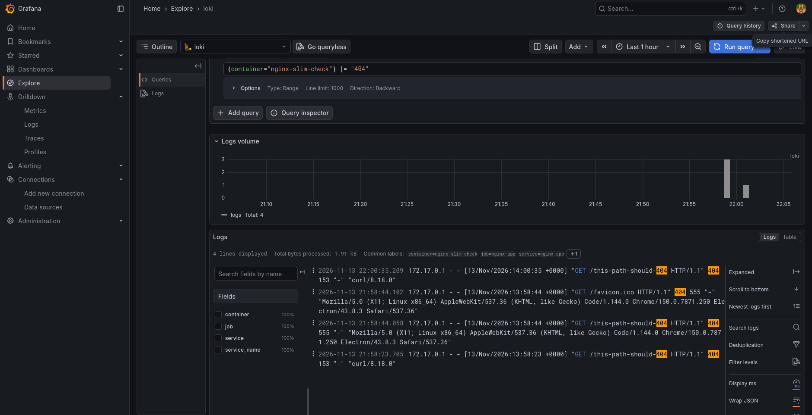

# NGINX DevOps Intern Assessment

[](https://github.com/KJakePortacio/devops-intern-final/actions/workflows/ci.yml)

**Name:** Khristian Jake Portacio  
**Submission date:** November 13, 2026

## Architecture

```text
GitHub source → GitHub Actions CI → GitHub Container Registry → Nomad + Consul → Promtail → Loki → Grafana
```

GitHub Actions checks the shell scripts and Dockerfile, builds the image, and tests the container. On a push to `main`, it publishes the commit-SHA and `latest` image tags to GHCR. Nomad deploys a selected GHCR tag and registers an HTTP health check with Consul. Promtail collects Docker container logs for Loki, which Grafana queries.

## Prerequisites

Versions used for this local assessment:

- Docker Engine 29.9.3
- Docker Compose 5.7.1
- Docker Buildx 0.39.0
- Nomad 2.1.1
- Consul 2.1.0
- ShellCheck 0.11.0
- Git

## Quick Start

Run these commands in a terminal to clone the public repository, build the NGINX image, start it, and check both endpoints:

```bash
git clone https://github.com/KJakePortacio/devops-intern-final.git
cd devops-intern-final
sudo docker build --build-arg BUILD_SHA=manual-002 -t devops-intern-final:slim-test ./app
sudo docker run -d --name nginx-slim-check -p 8080:8080 devops-intern-final:slim-test
./scripts/healthcheck.sh http://localhost:8080
curl -i http://localhost:8080/
curl -i http://localhost:8080/healthz
sudo docker image inspect --format '{{.Size}} bytes' devops-intern-final:slim-test
```

The observed health-check output was `PASS: http://localhost:8080 returned HTTP 200`. Both `/` and `/healthz` returned HTTP 200. The image size was `21299534 bytes`.

## Task 1 — Source control

The project was developed incrementally on the `feature/project-scaffold` branch with conventional commit messages. [Pull request #1](https://github.com/KJakePortacio/devops-intern-final/pull/1) was merged into `main`. The final `v1.0.0` tag remains to be created after the documentation is complete.

## Task 2 — Linux scripts

Run the scripts and lint them with:

```bash
./scripts/sysinfo.sh
./scripts/healthcheck.sh
shellcheck scripts/sysinfo.sh scripts/healthcheck.sh
```

Observed application check:

```text
PASS: http://localhost:8080 returned HTTP 200
```

`sysinfo.sh` reports the user, effective UID, hostname, kernel release, ISO-8601 date, disk and memory use, and Docker daemon status. `healthcheck.sh` accepts a URL as its first argument and defaults to `http://localhost:8080`. Both files are executable in Git (mode `100755`). ShellCheck 0.11.0 reported no issues.

## Task 3 — Containerisation

The image uses the pinned `nginx:1.30.6-alpine3.24-slim` base image, serves the static page on port 8080, runs as the `nginx` user, and provides `/healthz`. `BUILD_SHA` is substituted into the page at build time.

Build and inspect the image:

```bash
sudo docker build --build-arg BUILD_SHA=manual-002 -t devops-intern-final:slim-test ./app
sudo docker image inspect --format '{{.Size}} bytes' devops-intern-final:slim-test
sudo docker inspect --format '{{.State.Health.Status}}' nginx-slim-check
sudo docker exec nginx-slim-check id
```

Observed output:

```text
21299534 bytes
healthy
uid=101(nginx) gid=101(nginx) groups=101(nginx)
```

`curl -i http://localhost:8080/` returned HTTP 200 and displayed build identifier `manual-002`. `curl -i http://localhost:8080/healthz` returned HTTP 200.

## Task 4 — Continuous integration

`.github/workflows/ci.yml` defines lint, build, test, and publish jobs. Lint runs ShellCheck and Hadolint. Build passes `BUILD_SHA` from the GitHub commit and saves the image for the test and publish jobs. Test waits for the container health check and calls `scripts/healthcheck.sh`. Publish runs only on pushes to `main`, uses `GITHUB_TOKEN` with package write permission, and pushes the commit-SHA and `latest` tags to GHCR.

The pull request checks passed for lint, image build, and container test. The push to `main` also completed successfully, including publishing both the commit-SHA and `latest` tags to GHCR. The deployed image tag was `113d159a86fdc88d8bb886f694733638a92e8b1e`.

## Task 5 — Nomad deployment

The job specification is [nomad/nginx-app.nomad.hcl](nomad/nginx-app.nomad.hcl). It defines one service group and Docker task, a dynamically allocated `http` port mapped to container port 8080, Consul registration with an HTTP `/healthz` check, restart and reschedule policies, and rolling updates with automatic revert. CPU and memory are set to the required 100 MHz and 64 MB.

Validate, plan, and deploy the job with the published commit-SHA tag:

```bash
nomad job validate nomad/nginx-app.nomad.hcl
nomad job plan -var="image_tag=113d159a86fdc88d8bb886f694733638a92e8b1e" nomad/nginx-app.nomad.hcl
nomad job run -check-index 0 -var="image_tag=113d159a86fdc88d8bb886f694733638a92e8b1e" nomad/nginx-app.nomad.hcl
nomad job status nginx-app
nomad alloc status 08e49e3d
```

Observed validation result:

```text
Job validation successful
```

The plan reported that all tasks were successfully allocated. Deployment `ed9bb92c` completed successfully with 1 of 1 allocations healthy. Job status was `running`; allocation `08e49e3d` was `running` and healthy. Nomad assigned host port `26638`, mapped to container port `8080`.

Verify the application and Consul check:

```bash
./scripts/healthcheck.sh http://127.0.0.1:26638
curl -i http://127.0.0.1:26638/healthz
curl -sS 'http://localhost:8500/v1/health/service/nginx-app?passing' | python3 -m json.tool
```

Observed health-check output:

```text
PASS: http://127.0.0.1:26638 returned HTTP 200
```

The `/healthz` request returned HTTP 200 with body `ok`. Consul reported the `http-health` check as `passing`, with output `HTTP GET http://127.0.0.1:26638/healthz: 200 OK`.

## Task 6 — Log aggregation

The pinned Loki, Promtail, and Grafana stack, startup instructions, labels, LogQL query, observed result, and troubleshooting notes are documented in [monitoring/loki_setup.md](monitoring/loki_setup.md).

The query `{container="nginx-slim-check"} |= "404"` returned four NGINX access log entries with HTTP 404 status.



## Troubleshooting

- Docker was initially unavailable (`docker: command not found`). Installing Docker Engine and starting its service resolved this.
- The initial Dockerfile build failed because `FROM nginx: 1.27-alpine` contained a space after the colon. Removing the space fixed the Dockerfile parse error.
- The first image was about 75 MB, above the 60 MB requirement. Using the pinned Alpine slim image reduced its inspected size to 21,299,534 bytes.
- Loki's readiness endpoint initially reported that the pattern ingester was waiting for 15 seconds. Waiting for startup to finish resolved this.
- Promtail's initial container-name pattern missed `nginx-slim-check`. Updating the pattern and restarting Promtail allowed the 404 access logs to appear in Loki.

## Known limitations

- Nomad and Consul are running as single-node development agents; this is not a production cluster.
- Grafana uses a local assessment password and local Docker volumes.
- Promtail 3.6.4 is pinned to meet the assessment requirement. Promtail reached end of life in March 2026; a maintained deployment should migrate log collection to Grafana Alloy.
- The `v1.0.0` release tag remains to be created after the final documentation update.
